# Hack-DevTools

Hack-DevTools puts an HTTP request editor, response viewer, and payload library inside Chrome and Firefox DevTools. Bring a request over from Network, edit it, and see what comes back.

| Light                                                                     | Dark                                                       |
|:-------------------------------------------------------------------------:|:----------------------------------------------------------:|
| 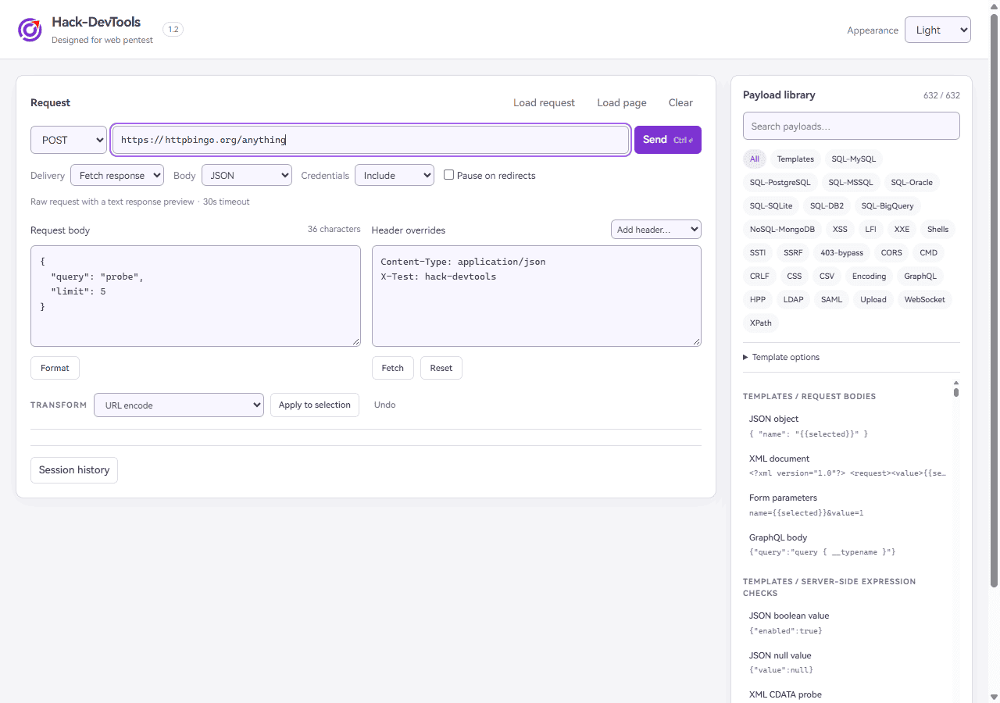 | 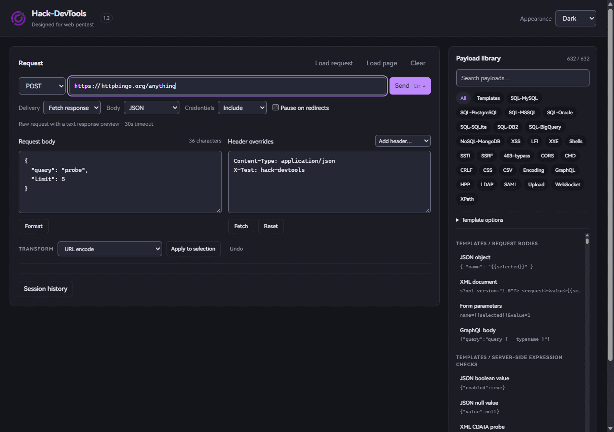 |

Choose **Light**, **Dark**, or **System** from **Appearance**.

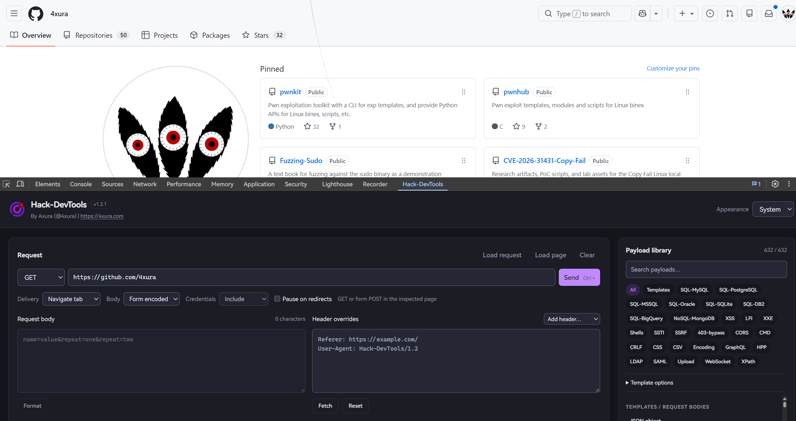

Unlike traditional intercepting proxies such as BurpSuite, this lightweight penetration testing toolkit operates directly in your browser, enabling real-time security testing without switching tools.

## Install

### From a release

**Chrome:** Download and extract the Chrome ZIP from [GitHub Releases](https://github.com/4xura/hack-devtools/releases/latest). In `chrome://extensions`, enable **Developer mode**, click **Load unpacked**, and select the extracted folder.

**Firefox:** [Download the Mozilla-signed XPI](https://github.com/4xura/hack-devtools/releases/download/v1.2.2/hack-devtools-firefox-1.2.2-signed.xpi). Open `about:addons`, choose **Install Add-on From File…** from the gear menu, and select the downloaded `.xpi`. Confirm Firefox’s permission prompts. This works in standard Firefox and stays installed after a restart.

Open a web page, open DevTools, and select **Hack-DevTools**. Look in the tab overflow menu if it’s hidden.

In Firefox, the toolbar button opens the full request workspace for the active tab. You can move it using Firefox’s toolbar customization.

### Build from source

On Windows with Node.js 22 or newer, run this from the repository root in PowerShell.

```powershell
npm run package:all
```

For Chrome, select `dist/chrome-unpacked` in **Load unpacked**. The Firefox build is in `dist/firefox-unpacked` for signing. The build also creates `dist/hack-devtools-firefox-<version>-unsigned.xpi` for Firefox Developer Edition and Nightly.

## Send a request

1. Choose a method and enter a URL, or click **Load page** to start from the inspected tab.
2. Choose **Fetch response** to see the result in the panel, or **Navigate tab** to open a GET or submit a form POST in the inspected tab.
3. Set the body format and headers as needed, then click **Send**.

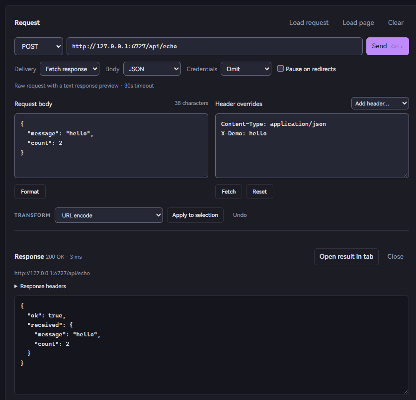

### Format a request body

Choose **POST** and set **Body** to **JSON**. Paste the object into **Request body** and click **Format** below it. In this example, Format adds quotes to the keys and removes the trailing comma.

| Before Format                                                                                                  | After Format                                                                            |
|:--------------------------------------------------------------------------------------------------------------:|:---------------------------------------------------------------------------------------:|
| 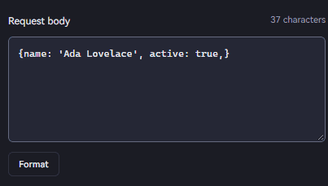 | 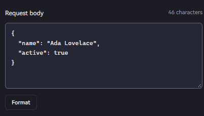 |

With **Form encoded** selected, Format also converts fields such as `name: Ada Lovelace` to `name=Ada+Lovelace`.

### Fetch page headers

Open Hack-DevTools on the page whose headers you want, then click **Fetch** below **Header overrides**. Review the headers it fills in. **Reset** clears the box. In Firefox, reload the inspected page first if there are no captured headers.

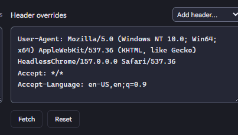

## Bring a request from Network

In Chrome’s **Network** panel, right-click a request and choose **Copy as cURL**, **Copy as PowerShell**, or **Copy as Fetch**.

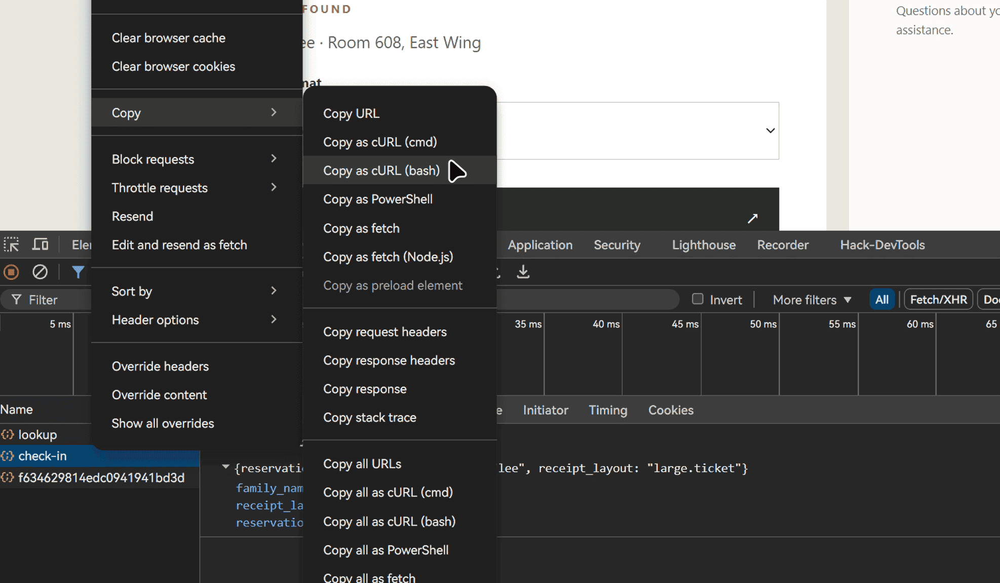

In Hack-DevTools, click **Load request**:

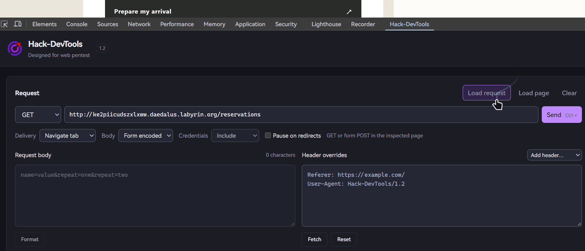

Paste it, then click **Load into editor**. Review the populated fields before sending.

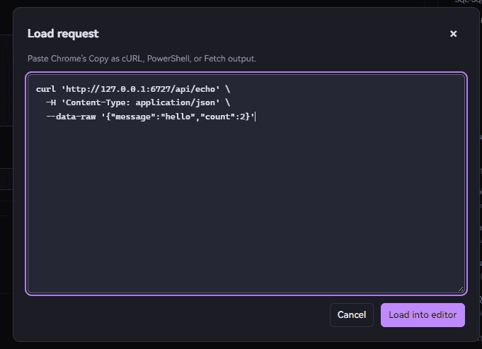

## Insert and transform text

The library has **600+ snippets across about 30 categories**. Start with **Templates** for JSON, XML, forms, and GraphQL, or search by name and category.

### Insert a Payload

Here we take an example of inserting a  commonly used JSON template:

1. Choose **POST**, **Fetch response**, and **JSON**. Type `Ada Lovelace` into **Request body** and select it.
2. In **Templates**, click **JSON object**. The selection becomes `{"name": "Ada Lovelace"}`.

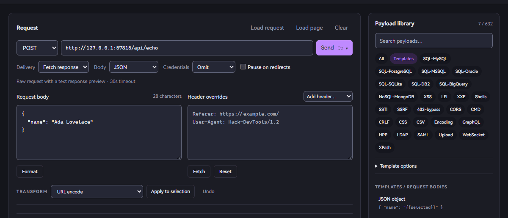

### Customize a template

Open **Template options** below the category buttons in the Payload library. Fields such as **Columns**, **Host**, and **Probe value** fill in placeholders when you insert a snippet. Change the fields that match the snippet you’re using.

Turn on **URL encode inserted payloads** when the entire snippet needs to fit inside one URL parameter.

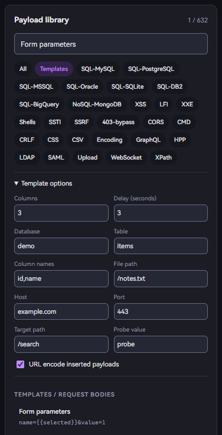

### Encoding Transform

For example, encode part of a form value:

1. Choose **POST** and set **Body** to **Form encoded**. Enter `q=tea & toast&limit=5` and select just `tea & toast`.
2. Choose **URL encode** in **Transform** and click **Apply to selection**. The body becomes `q=tea%20%26%20toast&limit=5`. Click **Undo** to restore the original.

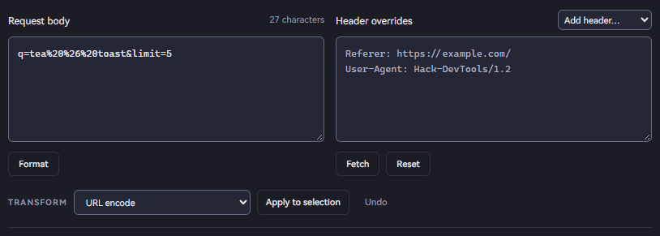

There are plenty of encoding methods, including some bypass techniques:

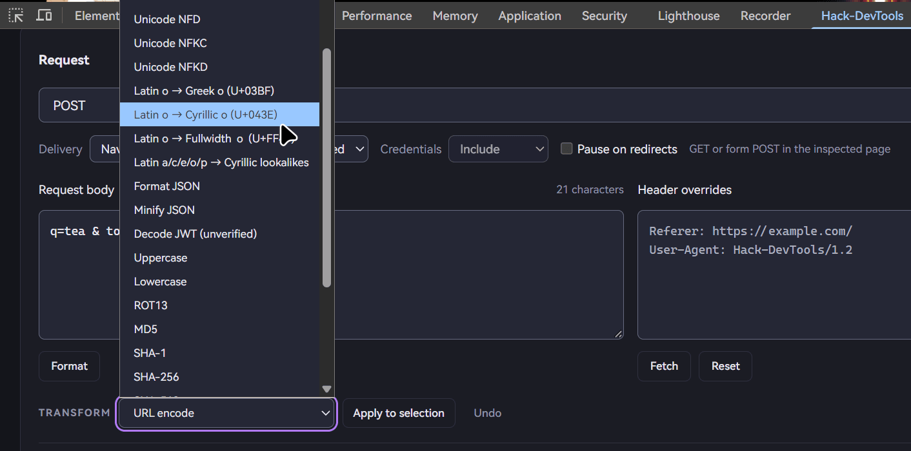

### Use the Scratchpad

Open **Scratchpad** below **Session history** to try snippets and transforms before copying the result into a request.

1. Type `Ada Lovelace` in Scratchpad and select it. Choose **Templates** → **Form parameters**. Scratchpad now contains `name=Ada Lovelace&value=1`.

   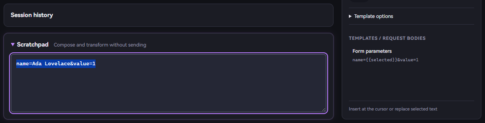

2. Select just `Ada Lovelace`. In **Transform** above Session history, choose **URL encode** and click **Apply to selection**. The result is `name=Ada%20Lovelace&value=1`. Click **Undo** to restore the previous text.

   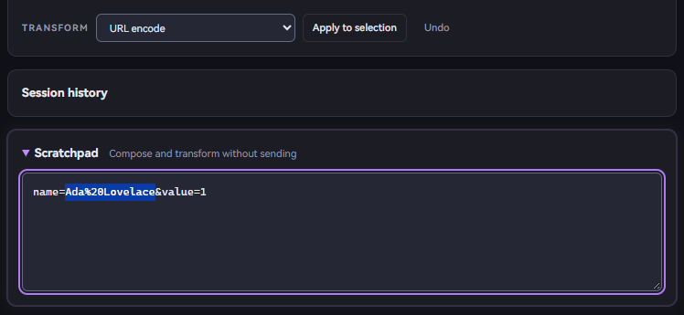

## Follow redirects and jobs

### Inspect a redirect

In Chrome, select **Fetch response** and check **Pause on redirects**. Choose **Edit next request** or **Follow with Fetch** at each hop. For a GET, **Navigate tab** opens the destination in the inspected tab. Firefox Fetch follows redirects automatically.

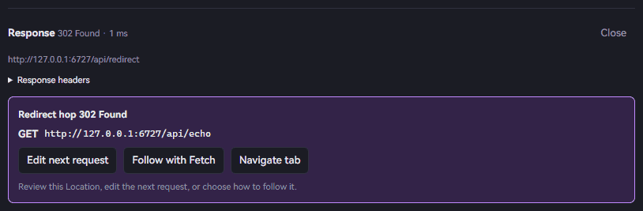

### Poll an API job

For a response with a job ID, open **Follow-up request**. Set the GET URL template and the API’s state and result fields, then click **Poll until ready**. The extracted result appears above the follow-up controls.

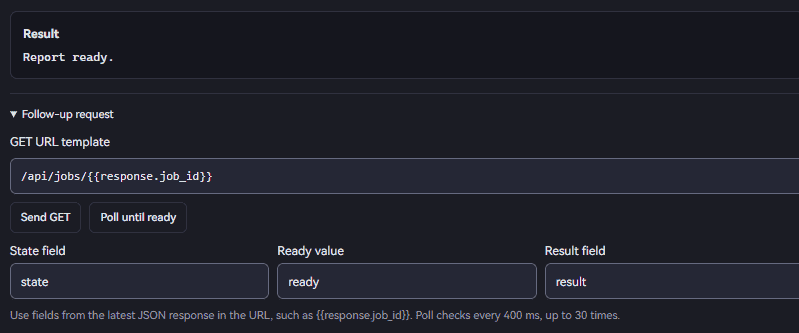

## Reuse a saved request

Open **Session history** below the response and select an entry to preview it:

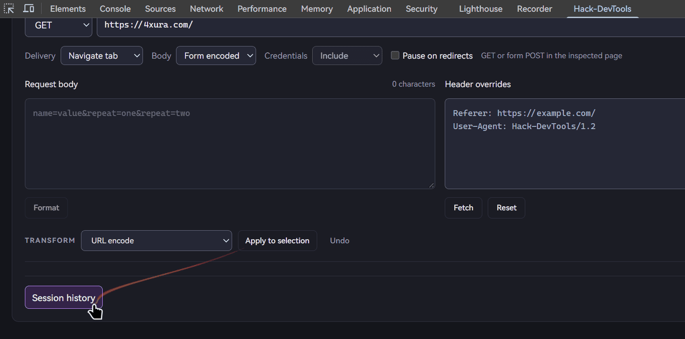

Click **Load into Request** to fill the editor for review. History keeps up to 30 requests per tab for the current browser session.

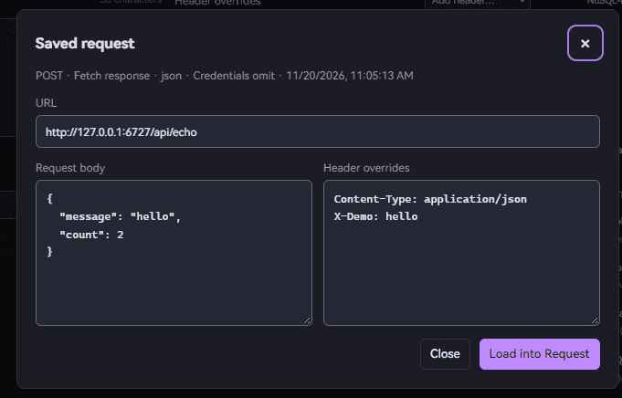

[Privacy policy](PRIVACY.md)
